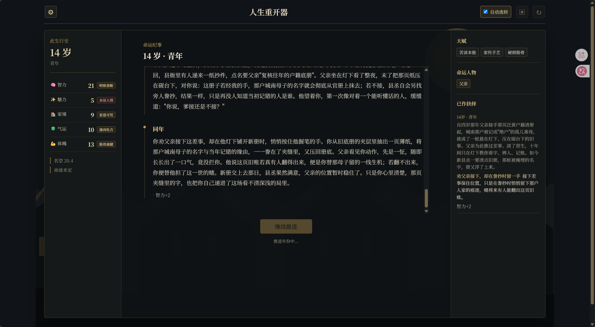
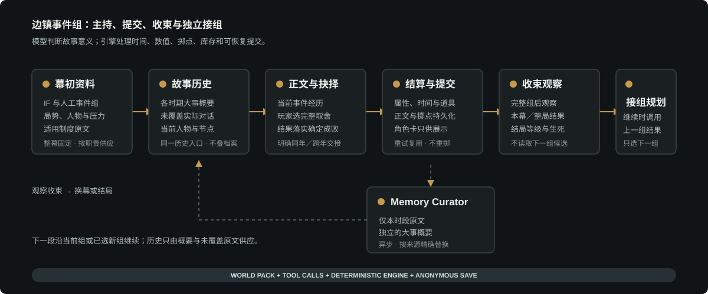

# Life Remake


**Life Remake** 是一个正在原型开发中的 AI 人生叙事游戏。玩家塑造人物、选择天赋，在完整事件的关键取舍上作出决定；模型讲述故事，规则引擎处理属性、时间、掷点、道具、提交和存档。

[快速开始](#快速开始) · [当前运行链路](#当前运行链路) · [扩展内容](#扩展内容) · [文档索引](./docs/README.md)



截图来自历史版本，界面和生成内容以当前代码与实际对局为准。

## 当前实现

仓库提供古代权谋、奇幻世界、现代都市三个基础世界，每个世界有六条 IF 人生路线。当前重点验证的是**边镇将帅的事件组链路**；其他路线尚未全部配置人工事件组。

| 范围 | 当前行为 |
| --- | --- |
| 边镇将帅，运行版本 20 | 人工预写 13 个可复用事件组、41 个完整单元；幕初模型组织主持资料并绑定名称，组内规划只路由下一单元，完整组结束后观察与接组 |
| 其他 IF，运行版本 18 | 使用整幕主持资料与实际历史推进，观察器判断本幕或整局是否收束 |
| 时间 | 正文和独立抉择结果明确交接同年或跨年；换组、换幕不覆盖交接 |
| 普通生活 | 边镇素材在适合的事件衔接处配置生活年数范围，引擎一次选定并保存；不因属性达标就跳过，也不在连续战斗中插入 |
| 抉择 | 玩家选择后由引擎持久化一次掷点，结果正文落实已经确定的行动成败 |
| 连续性 | 展示资产不反馈正文；边镇线严格整理事件组预设人物、地点、本领与道具的简短状态 |
| 历史 | 十年、幕末和终局提供压缩机会；只压缩本批未覆盖正文，各时段摘要独立保存 |
| 收束 | 观察器依据实际历史和 IF 标准判断继续、换幕或整局结束；提前结局不要求补完其余幕 |

本轮没有图记忆、五节拍任务链或逐轮导演式规划。角色卡与玩法库存分开：展示同步不能发放或消耗道具。

第二幕试点已获用户认可，其余边镇事件组按相同分工推广，见[材料与新局验证](./docs/FRONTIER_EVENT_ROLLOUT.md)。当前仍有实测问题：训练、值守和清点意象会反复出现，压缩有时仍保留过程细节，确定结果也有被正文改写的样本。完成一局、测试通过与叙事质量分别验收；此前实测保留在[历史记录](./docs/PERIOD_MEMORY_AND_EVENT_ROUTING.md)。

## 当前运行链路



1. **身世**：依据人设、天赋和 IF 家庭入口写出生环境，登记预设身份名称。没有独立身世摘要。
2. **幕初组织**：异步生成本局主持资料，包括局势、行动方、地点、压力与利益；本幕目的和收束依据取自 IF。世界卡整幕固定，适用制度原文由引用选入。
3. **准备与生活**：关键属性分别达标后取得准入，组内不因属性下降重新锁住。合适的事件之间仍有[素材配置的普通生活](./docs/ORDINARY_LIFE_INTERVALS.md)，准备期间经过的年份计入间隔；不再只有属性不足才能生活。
4. **故事与选择**：正文读取本幕资料、人物基础、同一份历史和当前节点；只接收当前节点或已选结果，未来分支不作为已发生事实供应。
5. **确定性提交**：结算属性、保存正文、已选行动、结果、时间交接与玩法库存。重试复用已保存结果和掷点，不重开已完成事件。
6. **路由与收束**：组内完整单元提交后，规划仅返回接续单元 ID；军议在原正文请求中依据规则处理实际功过。明确出口结束组后，观察器只判断收束；返回继续时，规划单独选择下一组。候选为空保留待处理来源，不要求观察器改判结束。
7. **展示维护与历史压缩**：连续性按既定频率整理角色卡，失败保留批次；历史压缩后台处理一个未覆盖时段。新摘要只替换准确覆盖的来源，同年新增经历保留原文。

固定职责、工具与本幕资料置前；历史、年龄、属性、候选和本轮任务置后。动态数据不改写 system 或工具 schema。

### 核心职责

| 工具／模块 | 职责 |
| --- | --- |
| `render_origin` | 出生正文与预设身份命名 |
| `plan_act_world_card` | 幕初组织主持资料；事件组路线同时选择候选与开场组 |
| `render_background_prose / render_scene_prose / render_choice_prose` | 生活、事件正文或待玩家作答的抉择 |
| `render_decision_outcome` | 落实已选行动与确定成败 |
| `route_event_unit` | 根据实际历史选择本组下一单元 ID，不改写材料或奖惩 |
| `render_event_settlement` | 按适用规则写完军议，提交规则 ID 与正文 |
| 属性结算工具 | 从最终正文提取规则允许的属性变化 |
| `sync_event_assets` | 边镇线预设角色卡展示状态；其他路线保留其连续性协议 |
| `observe_act_closure` | 本幕／整局收束、结局等级及适用时的主角生死 |
| `plan_next_event_flow` | 尚未收束时选择后续事件组，不裁定结局 |
| `curate_narrative_memory` | 生成当前时段的大事概要，由引擎替换对应历史 |

观察与规划不在每段正文后机械地全部执行。请求数、耗时和 token 以实际日志为准；Setting 中区分本地结果复用与服务商上报的前缀缓存。

## 快速开始

### 环境与启动

- Windows 10/11，Node.js 24.x、npm。
- 支持工具调用的 OpenAI 兼容模型服务；后端适配 Chat Completions 与 Responses，实际可用接口以服务商为准。

在项目根目录执行：

```powershell
.\start-local.bat
```

脚本在依赖缺失时安装依赖，并在缺少后端环境文件时从 `apps/backend/.env.example` 创建 `.env`。浏览器访问 `http://localhost:5173`，在 Setting 填写 API Key、地址及模型并确认本局环境，然后选择世界、IF、属性和天赋开局。

启动脚本会尝试释放本项目使用的 5173、4000 端口。`start-cloud.bat` 使用服务端模型配置，玩家不填写服务器密钥。详细配置见[配置指南](./docs/CONFIG_GUIDE.md)。

默认模型模板：

```dotenv
DEFAULT_PROVIDER_BASE_URL=https://api.deepseek.com
DEFAULT_PROVIDER_MODEL=deepseek-v4-flash
DEFAULT_PROVIDER_API_PATH=/chat/completions
```

也可手动启动：

```powershell
npm ci
if (-not (Test-Path apps/backend/.env)) { Copy-Item apps/backend/.env.example apps/backend/.env }
npm run dev
```

已有 `.env` 时沿用该文件。运行时密钥不进入持久化游戏存档；模型请求会发送人物设定、相关世界资料和实际故事历史给配置的服务商。

### 构建与验证

```powershell
npm test -w @reroll/backend
npm run build
```

截至 2026-11-06，269 项后端回归与共享／后端／前端构建通过。相关协议回归覆盖两种 provider 传输；实际整局模型验证使用限额 key 和隔离存储，不能替代其他模型及其他路线的实测。

`scripts/` 保存可复用的完整对局与原文回放脚本。模型实测会消耗 API 额度，需要手动执行；不会随普通回归运行。具体入口与记录方式见[仓库文件与验证记录](./docs/REPOSITORY_HYGIENE.md)。

## 匿名存档与本地文件

浏览器使用 HttpOnly 匿名会话 Cookie。当前局、存档槽和分支快照保存在 `storage/anonymous-game-store.json`；运行配置、自定义内容、备份与模型抓包也位于 `storage/`。

默认运行局保留 7 天、会话 30 天、存档 180 天，每会话最多 5 个手动存档；可通过 `ANONYMOUS_*` 配置。恢复存档创建新的当前分支。旧运行协议的存档保留查看，不自动迁移或重写历史。

`storage/` 与 `Material/` 不入库。部署时需要单独持久化和备份运行数据；当前文件存储适用于单后端实例。Git 保存源码、静态素材、脚本和文档，不能替代玩家存档备份。

## 扩展内容

| 内容 | 位置 |
| --- | --- |
| 基础世界配置 | `data/worlds/<worldId>.json` |
| 共同设定与力量目录 | `data/narratives/<worldId>.story.json` |
| 制度、地域及局部知识 | `data/narratives/world-cards/<worldId>/**/*.json` |
| IF 入口、三幕目标与结局标准 | `data/narratives/story-packs/**/*.json` |
| 人工事件组 | `data/narratives/event-flows/*.json` |

加载器发现 IF 文件，不在引擎绑定路线数量。开局快照所选路线及事件骨架；编辑文件不回改进行中的故事。世界卡描述局势和条件，正文负责实际发生的经历。

新增世界从[基础模板](./examples/world-pack/WORLD_PACK_GUIDE.txt)与[IF 模板](./examples/world-pack/STORY_PACK_GUIDE.txt)开始；事件组制作参考[事件组实现](./docs/EVENT_FLOW_IMPLEMENTATION.md)。世界资料的字段职责与实际供应见[内容规范](./docs/NARRATIVE_WORLD_CARD_DESIGN.md)。

首次运行会初始化 `storage/custom-content.json`；已有安装增加世界时需同步其世界列表。修改静态内容后重启后端，新规则以新局验证。

## 工程结构

```text
apps/backend/src/
  ai.ts                       模型适配、固定工具与最终请求
  engine.ts                   属性、时间、掷点、库存与提交规则
  narrative.ts                世界资料、状态和任务投影
  narrative/task-contracts.ts  各请求固定职责
  narrative/event-flow.ts      事件组游标、候选与道具结果
  narrative/finalization.ts    收束观察与独立接组交接
  narrative/event-assets.ts    预设角色卡状态
  narrative/story-history.ts   唯一历史供应
  narrative/curator.ts         分时段摘要与精确覆盖
  narrative/context/          材料组装与职责投影
  store.ts                    匿名会话与文件存档
apps/frontend/                React、TypeScript、Vite 阅读与操作界面
packages/shared/src/          共享类型的 TypeScript 源码
data/                         可提交的静态世界和事件素材
scripts/                      可提交的验证、回放及统计脚本
docs/                         当前规范、历史记录与文档图片
storage/                      忽略：本地运行数据、抓包与备份
Material/                     忽略：私人参考素材与测试密钥
```

前端和共享包源码旁的 `.js / .d.ts` 为当前 TypeScript 构建产物，已取消跟踪并忽略。后端手写类型声明继续入库，不使用全局 `*.d.ts` 或 `*.txt` 忽略规则。详见[文件清单与边界](./docs/REPOSITORY_HYGIENE.md)。

## 项目文档

[文档索引](./docs/README.md)按当前规范、操作说明与历史实测分类。优先阅读：

- [当前架构与完整运行链路](./docs/ARCHITECTURE.md)
- [分时段记忆、上游溯源与独立接组](./docs/PERIOD_MEMORY_AND_EVENT_ROUTING.md)
- [使用流程](./docs/USAGE_FLOW.md)
- [配置指南](./docs/CONFIG_GUIDE.md)
- [仓库文件与验证记录](./docs/REPOSITORY_HYGIENE.md)
- [更新日志](./docs/CHANGELOG.md)

## 许可

代码采用 [MIT License](./LICENSE)。模型服务由使用者自行配置，相关费用与数据处理遵循服务商条款；依赖保留各自许可证。
